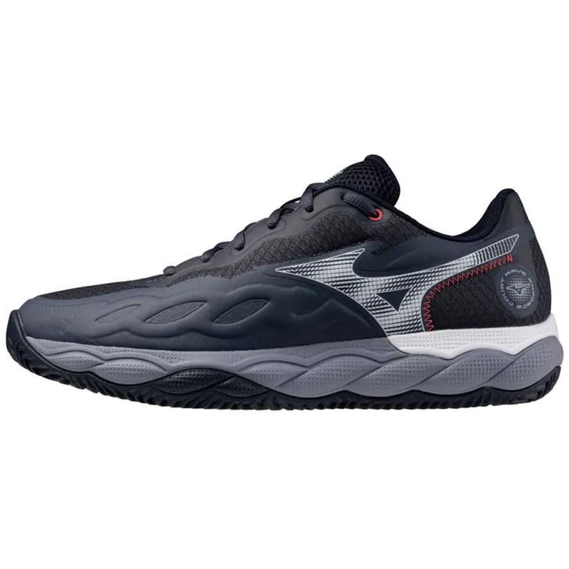

# Product Card

Um card de produto desenvolvido com **HTML e CSS puro** como parte da minha jornada de aprendizado em desenvolvimento Front-end.

## 🌐 Projeto

**[Acessar o projeto online](https://josecarlos006.github.io/ProductCard/)**

## 📸 Preview



## 🚀 Tecnologias

- HTML5
- CSS3

## 📌 Sobre o projeto

Este é o segundo projeto da minha sequência de 50 projetos práticos em desenvolvimento Front-end.

O objetivo foi criar um card de produto de uma loja virtual, praticando conceitos de HTML e CSS.

O projeto apresenta:

- Imagem do produto
- Selo de desconto
- Nome do produto
- Preço antigo
- Preço promocional
- Botão de adicionar ao carrinho
- Efeitos de hover
- Layout responsivo

## 🎯 Objetivo

Praticar os fundamentos de **HTML e CSS**, principalmente:

- Estrutura de elementos
- Box Model
- Flexbox
- Posicionamento com `relative` e `absolute`
- `border-radius`
- `box-shadow`
- `aspect-ratio`
- `object-fit`
- Cores
- Tipografia
- `hover`
- Responsividade

## 💻 Como executar

1. Clone o repositório:

```bash
git clone https://github.com/josecarlos006/ProductCard.git